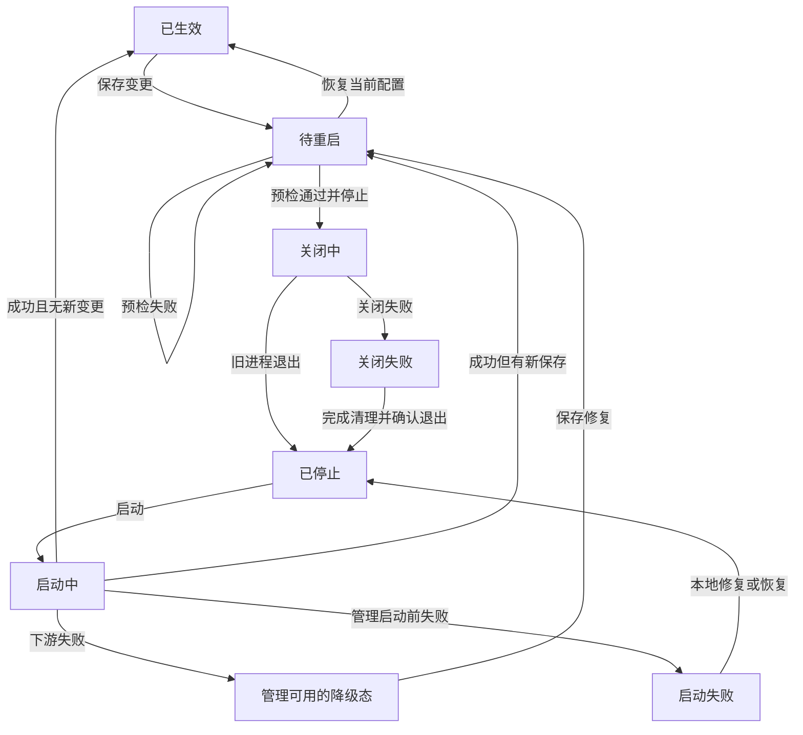

# 配置重启生效决策（规划中）

推荐将影响运行的配置统一为“保存 → 待重启 → 新进程启动成功后生效”。首期由操作者通过现有启动方式完成重启，不提供 WebUI 重启按钮。每次启动继续生成新的 Gateway Token。启动失败保留失败配置，由操作者修复或显式恢复上一个可用配置快照。

本文是 [#261](https://github.com/posanbu/Kaguya/issues/261) 的设计交付，供维护者确认和后续实施。当前完整 Profile 热应用仍然存在，公开 API 和测试保持原行为。现行说明见[配置生命周期](../developers/configuration-lifecycle)。本文选择的是一个目标模型；实施顺序不构成多个长期运行模式。

## 已核对的实现

核对基准为主线 `6debc01e953723b2171bd383bbd61120a480d63d` 与本地待集成提交 `50f01850b0afd7efc30e98c2f6ea9233c16dcaf1`。`ConfigurationApplication`、配置管理、FeatureManagement、模块/模板/人设管理及两份热应用测试在两者间没有差异。启动代码存在本地增量：`config.ts` 增加 native Memory 工具开关，Server 增加 MCP、环境和行动接线；这些不作为已合入主线的事实。

- **完整配置应用** — [`ConfigurationApplication`](https://github.com/posanbu/Kaguya/blob/6debc01e953723b2171bd383bbd61120a480d63d/apps/server/src/configuration-application.ts) 在共享写锁中核对 Profile 与 revision，预检后停止旧实例、启动新实例。失败时可恢复进程内旧快照，资源清理不安全时禁止再创建所有者。HTTP、数据库连接和 Gateway Token 不随这次应用替换。
- **专用开关** — [`FeatureManagement`](https://github.com/posanbu/Kaguya/blob/6debc01e953723b2171bd383bbd61120a480d63d/apps/server/src/feature-management.ts) 已只保存 Memory/NapCat 期望配置。`committed` 在 Server 中仅补充秘密脱敏历史，不启动功能。普通模块设置仍返回 `explicit_apply`，这两个模块返回 `restart_required`。Issue 中“是否一起改为待重启”的问题已有部分实现答案。
- **状态覆盖范围** — 当前快照只有 Profile、模块设置和插件树。Prompt local、人设、名称、别名不在其中。完整应用读取模块时保留 Memory/NapCat 的启动配置，但仍读取磁盘插件树。因此当前 application revision 不能直接当作“所有磁盘配置是否已生效”的凭据。
- **版本与保存** — revision 是进程私钥生成的 HMAC。跨进程不稳定，也不能用作持久恢复标识。`ConfigurationManagement` 的 `restartRequired` 是进程内累积布尔值，恢复原值也未必清除。保存后无法读取其他模块快照时，保存接口仍可成功并省略 `application`。
- **冷启动边界** — [`startKaguyaServer`](https://github.com/posanbu/Kaguya/blob/6debc01e953723b2171bd383bbd61120a480d63d/apps/server/src/server.ts) 在 HTTP 之前读取 Registry、模块、插件和 runtime。此阶段失败会退出；strict 数据库 schema 不兼容也会退出。AI 配置不完整、数据库暂不可用、Runtime 启动失败可进入带管理 HTTP 的降级态。`/healthz` 只证明 HTTP 存活。
- **启动方式** — `pnpm start` 直接启动 Server。`pnpm dev` 经 PostgreSQL CLI 启动开发进程并转发信号，没有统一的重启请求、启动确认或失败重试协议。退出旧进程不能作为新进程启动成功的证据。

## 唯一推荐范围

**下次启动生效** — selected Profile 的模型、凭据引用、身份字段、双向白名单和 runtime；全局模块设置、启停和 `cordis.yml`；Memory/NapCat 的专用开关及设置；模块模板、名称、别名、人设等 Prompt local 文件。插件包安装/版本切换也在新进程装载。启动环境变量和已导入插件代码变更同样要求重新启动，但不伪装成可由配置 API 保存的字段。

**保存即完成** — 创建、编辑、删除未选中的 Profile 只改变配置仓库，不影响当前服务，也不为当前服务增加待重启标志。切换 selected Profile 是一次期望配置变更，不立即切换运行身份。编辑器当前打开哪个 Profile 是浏览状态，不参与判断。

**保留即时操作** — 查询、取消任务、撤销授权、停止危险操作属于运行控制，按其原有契约立即处理。它们不经“保存配置”延迟到重启。保存更严格的白名单或关闭 NapCat 仍只改变下次启动配置；需要立刻阻止发送时应使用现有停止/取消能力，不能向用户宣称保存已经撤权。

统一范围可以移除完整 Runtime 在同一进程内切换、部分配置排除和旧实例回滚的组合。代价是每次生效都断开连接，并需要重新打开访问链接。本文接受这项代价，但以冷启动恢复、停止边界和本地修复入口先完成验收为前提。

## 保存与运行状态

后续状态服务分开记录磁盘期望配置、当前进程实际装载配置、Runtime 可用性和重启操作。不能继续用一个 `ready/pending/degraded` 同时表示四件事。

**desired** — selected Profile ID、完整输入的进程内 revision、读取/校验状态以及安全的变更类别。读取失败时 revision 为空，返回固定错误码，不把上一份成功快照冒充当前磁盘内容。

**loaded** — 本次 `bootId`、实际读取的 `snapshotId` 和 Profile ID。HTTP 可用但 Runtime 失败时仍可说明读了什么，不能将其称为“运行已生效”。启动读取后发生的保存不改变 loaded。

**active** — 仅 Runtime 成功装配、所有权取得且入口准备完成后记录的配置身份。可用性另外返回 `ready/degraded/stopping`。NapCat 暂时重连或等待登录以 Adapter 状态表示，不自动让整个配置回到待重启，也不宣称 QQ 已在线。

**pendingRestart** — 磁盘配置与当前 active 配置是否不同。使用规范化后的完整内容比较，包含 local override 是否存在及有效来源。成功运行且内容相同为 `false`；不同为 `true`；磁盘不可读或尚无 active 为 `null`，同时给出失败/初始化状态。使用内容比较，不以修改时间或保存次数推断。Profile ID 不同仍视为切换，即使模型配置相同。

**restart** — 首期恒为 `capability: manual`。以后若接入 supervisor，才增加操作 ID、阶段、目标 snapshotId 和失败码。`bootId`、snapshotId、重启操作 ID 是随机不透明标识；对外不暴露可猜测秘密内容的裸摘要。

状态转换如下。图中的“已生效”要求 active 存在且与最新 desired 相同；启动成功后若磁盘又有新保存，则进入“待重启”。

图中“待重启”也包括修复已保存但尚无 active 的情况；这时 API 的 `pendingRestart` 仍为 `null`，页面同时显示启动失败，不能投影为健康运行。

状态与操作的具体规则：

1. 保存只确认对应文件已经提交。校验失败返回 400 且不写入；并发版本冲突返回 409；写入或恢复失败返回固定错误码。保存成功后全局快照读取失败，应返回“已保存，整体配置暂无法检查”，保留 `persisted: true`，不得返回“已生效”。
2. 连续保存合并为当前磁盘期望，不建立重启队列。相同内容重复保存不增加操作，切回 active Profile 并恢复全部全局设置后可清除 pending。编辑未选中 Profile 不改变此比较。
3. 保存与启动快照捕获共用配置写锁。未来重启提交必须匹配预检 revision；若已有新保存，拒绝旧请求并要求重新读取。开始关闭后拒绝新的管理写入。手工停止时也执行相同冻结边界。
4. 新进程重新读取磁盘并验证；它不信任旧进程的 HMAC。手工重启采用启动时最新磁盘内容，预检只是前置检查，不承诺跨进程绑定。若配置在停止后又变化，启动日志和状态说明实际装载的 snapshotId。
5. 恢复失败配置也是一次新的保存。保持失败候选、错误阶段和最后成功启动记录，便于复查。已存配置不因启动失败被静默覆盖。

用户可见文案限定为事实，例如“已保存，重启后生效”“正在关闭，暂不接受新任务”“新配置启动失败，管理功能可用”“服务未启动，请在本地修复”。不在产品页面展示 HMAC、lease 或数据库 claim 等实现字段。

## 校验、快照与失败恢复

### 三个校验时点

**保存时** — 继续执行各配置域的 schema、引用、模板编译、路径与权限检查。允许现有初始化流程保存尚不具备运行 readiness 的配置，但明确返回未完成项。局部保存不导入第三方插件、不连接 Provider、不调用模型或 NapCat。

**停止前** — 对完整候选执行可重复的本地预检：selected Profile 一致性、模型引用、runtime 与 loopback host、全部模块设置、插件声明和包可解析性、模板/local 来源。模块设置校验仅使用已可信装载或可静态读取的 schema 声明；新装/损坏插件无法安全取得 schema 时返回“待启动验证”，不报告完整预检通过。返回安全的失败阶段和字段名。数据库可做受限只读连通性/版本/schema 检查，暂不可用时标明“未验证”，首期手工操作者决定是否继续。预检不得执行 schema 迁移、Kind 写入或启动插件。当前热应用的 `validate` 会装配插件并准备数据库，不能原封不动改名为无副作用预检。

**新进程启动时** — 在固定输入上重复必需校验，并实际装配插件、数据库和 Runtime。只有此阶段能够证明启动成功。启动成功不等于远端模型请求成功或 QQ 登录完成，后两者保留独立状态。

### 上一个可用快照

建议新增配置根下私有的启动记录与快照存储。快照包含选中 Profile、选中关系、全局模块/插件树、所有实际使用的 Prompt local 内容及“override 不存在”的记录。还保存代码提交、配置 schema、插件包路径及完整性标识、模板声明版本和数据库身份的私有引用。快照不复制整个项目、不包含数据库或 Gateway Token。

Prompt 文件目前可能位于配置根之外。快照清单必须从受信声明收集逻辑资源 ID，恢复器只通过已登记的资源写接口写回；不能照着用户可编辑清单中的任意绝对路径写文件。插件包引用必须仍存在且完整性匹配。代码、包或 schema 不兼容时拒绝恢复，给出具体缺项，不假设旧配置能恢复旧代码。

快照含凭据，沿用私有目录、原子文件替换、拒绝符号链接和路径逃逸的规则，不放进 Git、公开 API、普通日志或下载链接。默认只保留当前启动候选和上一份成功配置；失败记录只留脱敏元数据。更长历史由独立备份策略负责。

`lastKnownGood` 仅在 Runtime ready、入口所有权确认且必要启动步骤完成后推进。HTTP 存活、端口打开、`server.started` 但 `runtimeReady: false` 都不够。外部网络暂时离线不自动否定已经通过的本地配置装配。

正常 Server 启动和恢复 CLI 必须共同参与配置根的进程级独占所有权协议；现有进程内写锁不满足这一要求。进程锁覆盖整个服务寿命，恢复 CLI 只在服务退出后获得锁。以操作系统释放所有权为依据，不能只删除一个遗留 PID 文件后继续写入。

恢复包含多个文件，不能依靠各文件原子替换冒充跨文件事务。恢复器先验证全部目标，写私有恢复 journal 与旧内容，再逐项提交，最后标记完成；下一次启动必须先完成或回退未完成恢复，期间不启动业务。保留现有 Profile 的单文件原子写和权限检查。新增元数据使用独立版本，不修改业务数据库 schema。

### 两条修复路径

**管理 HTTP 仍可用** — 下游失败时保留管理界面、状态和配置读写，消息入口返回不可用。用户修复后再手工重启。恢复上个快照也按“写入期望配置 → 重启”执行，不在降级进程里秘密重建业务实例。

**管理 HTTP 未启动** — Registry/JSON、插件导入、runtime、安全路径、HTTP 绑定或数据库 schema 失败时，输出脱敏阶段和本地恢复说明。首期新增本地 recovery CLI，支持检查、列出最后成功快照、预览恢复差异和显式恢复。恢复须确认服务已停止并取得配置根独占写入权，使用同一用户和配置根；无法确认旧所有者退出就拒绝写入。它不加载失败插件、不要求先连上业务数据库。恢复后仍由操作者运行原启动命令。

首期不建立另一个常驻恢复 Web 服务，也不自动回滚。服务离线时优先恢复配置文件；数据库 schema 不兼容时交给部署迁移流程。恢复旧 Profile 不回退数据库、消息历史、revision、任务队列、授权记录或外部动作。数据库地址改变视为迁移：旧库未完成任务必须先导出/接管或明确留在旧部署，不能称为普通配置重启已恢复。

## 重启入口、supervisor 与 Gateway Token

首期 WebUI 只显示保存结果、实际运行状态和重启说明。手工步骤为：完成本地预检，停止当前实例，确认旧进程退出，再用原命令启动，打开这次输出的新访问链接，并检查 Runtime 与所需 Adapter 状态。开发启动使用 `pnpm dev`，生产构建启动使用 `pnpm start`；停止使用原终端或已有服务管理方式。使用已有服务管理器的部署按其明确配置操作，页面不能猜测 systemd unit 名称。

以后的一键入口必须由外部 supervisor 拥有以下责任，Server 只负责鉴权、冻结候选、关闭与启动回执：

- **唯一所有者** — supervisor 管理确定的可执行程序、工作目录、配置根和子进程组。确认旧 Server 及必须随它退出的子进程退出后才启动新实例。独立持久 shell job 可跨重启保留，新实例按原 operation ID、租约和 fencing 核对归属与结果；仅 PID 文件或 lease 到期不足以证明旧副作用已停止。配置根锁与数据库业务所有权都必须满足。
- **请求契约** — 采用本地受保护 IPC，拒绝从浏览器传入 shell 命令、环境变量或文件路径。管理认证成功后，接收目标 snapshotId、expected revision 与幂等请求 ID。同一请求返回同一操作，另一个目标在操作期间返回冲突。远端网页不能直接持有 supervisor 管理权。
- **候选绑定** — 受控重启从已验证的不可变候选启动，候选准备成功才允许停止。停止后出现的新磁盘保存保留为下次 pending，不替换此次候选。这个绑定与手工模式的“启动时读取最新磁盘”必须在入口上说明。
- **结果契约** — 操作区分 accepted、draining、stopped、starting、ready、degraded 和 failed。新进程回执包含 bootId、目标 snapshotId、代码提交、Runtime readiness；supervisor 核对目标与进程身份。端口探活可能命中旧进程，不能完成操作。
- **失败与超时** — 同一候选自动启动一次，失败后停止自动重试并报告阶段。关闭预算到期不能并发启动第二实例。强制终止是明确运维动作，先完成进程组终止和副作用未知状态记录；重试依然核对原操作。持久 journal 使 supervisor 自身崩溃后可以核对旧进程，而非盲目再启动。

Gateway Token 保持每个新进程随机生成、仅保存在内存的现行安全语义。旧 Token 对新进程返回 401，旧页面进入锁定状态；不能凭旧 Token换取新 Token，也不能将新 Token放在公开健康接口、重启状态或错误体中。新访问链接仅交给有权读取启动终端的操作者。首期不实现跨重启自动登录。以后若要一键重启后自动重连，必须另外设计有独立寿命和受限用途的会话/凭据交接协议，不能以延长 Gateway Token 寿命代替设计。

## 在途工作与关闭责任

正常关闭采用有界 drain。建议初始应用预算为 30 秒，supervisor 等待窗口至少覆盖该预算和资源关闭开销；具体数值由冷启动实验确认，不通过修改业务 deadline 让任务“来得及完成”。手工信号关闭沿用同一流程，不依赖 WebUI 点击。

1. **先停止接收、领取和 dispatch** — 标记 stopping，拒绝新消息入口、新业务任务、新配置写入和新 claim，并封住 Provider/工具/平台调用的 dispatch 边界。封口前已开始的调用可以完成回执与持久化；封口后即使任务早已接收，也不开始新的外部调用，交给持久恢复或显式取消处理。已经开始的保存完成提交或报错。读取管理状态可持续到 HTTP 关闭。目标配置的收紧权限尚未生效，不得假装已经用于旧任务。
2. **明确接受点** — 当前 `AdapterHost.webGateway.ingest` 仅在带 `conversationId` 时等待 submission，旧请求分支是 fire-and-forget；两者都可能得到 202，因此当前 202 不统一等于持久接受。目标持久入口必须先提交 canonical inbound、去重键和后续待处理记录，再返回 accepted。只在内存的工作不能获得“重启后保证恢复”的承诺。首期若某入口尚未达到持久接受点，切换默认行为之前必须补齐或在 drain 中等它到达可恢复边界。
3. **保留完成所需资源** — drain 期间保留封口前已开始调用所需的数据库、发送 transport、MCP 和环境租约，维持回执与核对通路。关闭应先停 ingress，再等待运行工作到达安全边界，随后关闭工具、Adapter 和数据库。当前关闭先 `adapterHost.stop()` 再释放 Runtime，整体 Adapter stop 未等待 `outboundInFlight`。本地 ActionExecutor.close 也只是 abort 活跃调用并等待恢复扫描，未等待所有调用的 finish/ack。不能仅凭 `close({ drain: true })` 就声称最后一条回复一定发出；后续切片须验证并调整顺序与持久化完成边界。
4. **分别处理工作状态** — 未领取的持久任务留在原队列；未发出副作用的进行中任务可取消执行并保留可恢复状态；已返回外部确认的任务先持久记录确认再关闭。已发出而未确认的动作记为 unknown，等待核对或人工处理，不能自动重发以“补齐回复”。QQ/外部工具不能承诺 exactly-once。
5. **恢复核对权利与时效** — 新进程在取得合法的新 epoch/lease 后读取原 action/request ID。重启不允许抢占仍有效的旧租约，当前本地恢复扫描只将过期 started/cancel_requested 转 unknown。重新核对授权、截止点、依赖版本、取消标记、目标身份及资源归属。延迟结果不得越过旧 fencing 写成新完成。配置改变不能把旧授权扩大到新工具或新目标；冻结输入与新配置不兼容时转为等待确认/重新规划，不重解释旧请求。已取消和已完成任务保持终态。
6. **冷启动接续** — 使用同一持久数据库恢复队列、观察截止点、经历 revision 和行动续段。Runtime 恢复消费须等待对应 Adapter/工具 ready；当前 Runtime 启动早于 Adapter，需要证明历史待投递不会提前被消费并永久失败。重复入站按持久标识去重；QQ 重连只恢复连接，不假设 NapCat 会补发全部断线期间消息。Web 临时身份继续走其既有跨进程契约，重启不能凭新 Token 赋予别人的会话权限。

预算耗尽时发出取消，记录仍在执行或结果未知的任务和清理阶段。若资源清理失败，保留失败态并禁止第二所有者启动。HTTP 的“关闭请求已接收”与 supervisor 的“新服务 ready”分别记录。配置层只协调停止，不另写行动执行器、授权系统或补发队列。

主线已有可靠队列、关闭和身份基础；本地 `50f0185` 额外接入行动/MCP/环境恢复。后者仍是待集成代码，需由 #249、#299–#303 的实际接口和验收提供保证。配置实现切换应消费它们的 quiesce、ownership、unknown 与恢复证据，不能仅引用设计文档宣称保证成立。

## API、页面与迁移影响

**配置状态** — 首个代码切片新增 `GET /api/v1/configuration/lifecycle`，使用 management 认证和 `Cache-Control: no-store`，提供上述分维状态。旧 `/configuration/status` 暂保持原格式。新接口可以显示 `effectModel: explicit_apply`，在目标模型正式启用时改为 `restart`，避免提前误报现状。

**保存接口** — Profile、features、module settings、module templates、identity/persona 都由同一快照服务返回 `persisted`、effect 和 pending 状态。已有域内 revision 校验保持。Profile 当前缺少等价的完整替换乐观并发保护，后续增加可选 expected revision 并让新版客户端携带；旧客户端兼容期维持原行为并标明覆盖风险，不能虚称当前保存已有全面 CAS。

**预检与恢复接口** — 新增受管理认证的 `POST /api/v1/configuration/preflight`，输入 expected revision，返回检查结果和不透明 candidate ID，不停止服务。首期恢复能力由本地 CLI 提供；以后需要 HTTP 恢复时使用固定 snapshotId、当前 revision 和幂等键，并受同一独占写入与 journal 约束。

**旧 apply API** — 设计交付不改动它。正式切换时保留路由与现有认证、参数格式、409/503 契约；先按旧格式核对请求 revision，再由完整快照服务确认 `pendingRestart === false` 才返回原有 `applied` 空操作结果，防止仅改 Prompt 时被旧 revision 漏掉。存在差异则返回已有 `restart_required` 结果，附新的 `restartReasons`（配置域），不停止进程。`restartFields` 继续只表达现有固定进程字段，避免用虚构字段误导旧客户端。快照不可读或没有 active 时返回固定失败结果，不返回 applied；能够确认修复后配置仍需启动时返回 restart_required。旧接口不承担重启、退出或恢复操作。更新 HTTP 文档和 API 客户端，并在独立兼容周期后再考虑移除该路由。

**WebUI** — 列出运行 Profile 和下次启动 Profile，统一显示 effect，避免将保存成功提示复用成生效成功。Memory/NapCat 同时显示期望设置、运行状态和重连/登录状态。首期无重启按钮。页面布局、按钮和样式实现由另一个 UI 任务处理，本设计只规定信息与操作语义。

**持久化迁移** — 保留现有 Profile/模块/插件树格式，不迁移业务数据库。首次运行没有成功快照时明确显示“尚无可恢复快照”。本地恢复元数据独立版本化，旧进程 HMAC 全部失效。模板根、插件包和数据库切换必须在预检与恢复清单中明确，不能让配置快照冒充部署备份。

## 冷启动验收与测试替换

以真实子进程边界确认“新进程”，再以真实 PostgreSQL 17 确认持久恢复。可控模型、假 Adapter 和本地合成工具服务负责协议测试；不发真实 QQ，不调用外部 LLM/付费语音。仅关闭再创建 `startKaguyaServer` 对象或每次创建全新的 PGlite，不能证明跨进程持久恢复。

### 必须保留或新增的场景

- **C01 保存和比较** — 连续保存、重复内容、切换/切回 Profile、只编辑未选中 Profile、修改后恢复原值；逐域覆盖模块、Memory、NapCat、模板、人设以及插件树。断言旧运行身份和行为不变，新状态准确。全局读取失败保留保存成功事实，revision 不泄漏秘密。
- **C02 预检和竞态** — 过期 revision、预检后再次保存、关闭与保存并发、重复重启请求、只读预检不改变数据库/文件。用 barrier 控制阶段，确认拒绝发生在停止之前。验证停止封口后未开始新的模型调用或外部动作，封口前已有调用仍可记录确认。进程重启后旧 revision 不可复用。
- **C03 正常冷启动** — 进程 A 接受合成消息并记录旧配置；保存 B 后 A 继续使用旧配置；停止 A，确认退出，启动 B。核对新 PID/bootId、实际 snapshotId、运行身份/白名单/模板/模块变化，HTTP 只监听一次。新配置同磁盘一致才清除 pending。
- **C04 鉴权** — 新进程使用新 Token；旧 Token 在 management/messages 返回 401，缺失/错误 Token 在输入校验前拒绝。重启、失败及快照 DTO 不出现 Token、API Key、数据库连接串、Prompt 正文或可穷举秘密的裸摘要。
- **C05 可修复启动失败** — 模型引用不完整、数据库暂不可用、Runtime 装配失败分别得到管理可用的降级态。保存修复不会误报 ready。再次冷启动后进入目标状态。NapCat 离线/登录失败只影响该 Adapter。
- **C06 管理前失败与恢复** — 损坏 Registry、插件加载失败、非法 host、端口占用、strict schema 不兼容分别验证固定错误阶段和退出结果。本地检查/恢复不依赖失败插件或数据库；恢复 journal 各提交边界崩溃后不启动混合配置。无法恢复的包/代码版本明确拒绝，业务数据库不被回退。
- **C07 graceful drain** — 在接受持久化、模型进行中、dispatch 前、外部已收到但确认未落库各点阻塞，再发停止信号。拒绝新入口/claim，带/不带 conversationId 两种入口的接受记录都可追踪；drain 时 transport 仍可用；迟到输出不能越过取消终态；cleanup 即使一项失败也继续其他释放。
- **C08 crash 与持久恢复** — 同一真实 PostgreSQL 库中终止进程 A，再启动 B，覆盖待处理、已 claim、已授权未 dispatch、unknown、已完成和已取消。等待原 lease/epoch 恢复条件，断言只有合法新 owner 可提交，原 action ID 不变，unknown 不重发，已确认发送计数保持 1，完整后续链收敛。故意延迟 Adapter ready，确认待投递保留原状态、ready 后才执行。
- **C09 新配置下恢复** — 恢复时授权撤销、任务过期、依赖 revision 改变、白名单收紧、环境租约被接管。保留原输入/来源，停止不再合法的动作；配置不兼容转显式待处理状态。停止期间已到期的 scheduler/模型/环境任务仍使用原 deadline，不因重启续期。切换数据库不会报告原队列已经接管。
- **C10 失败关闭与 supervisor** — 首期测试手工关闭失败不拉起新所有者。以后测试同 ID 幂等、不同目标冲突、旧进程未退出、端口被旧进程占用、supervisor 崩溃、错误启动回执、启动失败不循环，以及新 Token 只经受保护输出交付。

异步 fixture 检查 setup、启动、进入在途、停止、迟到结果、恢复和 cleanup 全部等待点。优先使用事件、Promise 与 barrier；真实 I/O 使用有界条件轮询。当前 `server-reload.test.ts` 两处轮询显式为 `{ timeout: 8000, interval: 20 }`，单例上限 45 秒；新 fixture 依真实 PG/子进程阶段设置统一预算与分阶段诊断，不照抄短默认值，不用固定 sleep 或反复重跑替代同步。超时路径必须释放 barrier、终止子进程、关闭连接并保留失败阶段。

### 热应用测试如何退出

目标行为尚未启用时保留 `configuration-application.test.ts` 和整个 `server-reload.test.ts`。在替代测试覆盖并通过后，才删除下列专属行为：同进程 Runtime/Adapter 重建但 HTTP/Token/数据库对象不变；新激活失败自动重建旧内存实例；同进程 rollback 失败后显式 retry；通过 apply 热加载外部插件；applying 状态下排队保存。

其余断言迁移而非删除：状态比较、并发冲突、秘密脱敏、认证优先、进程字段识别、部分保存成功、定向权限、插件/模板校验、Memory/NapCat 下次启动生效、拒绝第二所有者和降级恢复。对应 C01–C09，既有 `config.test.ts`、`configuration-management.test.ts`、`feature-management.test.ts`、`module-settings.test.ts`、`module-template.test.ts`、`identity-persona-management.test.ts`、`gateway-auth.test.ts`、`server-composition.test.ts` 与可靠队列/身份/行动测试继续保留。

### 验证证据层级

本设计只完成代码和测试静态核对，不报告运行通过。后续每份验收记录分开列确定性单元、PGlite、真实 PostgreSQL、真实子进程、合成服务、真实部署和远端 CI。实现发布前，记录最新 head SHA 对应的 Ubuntu/macOS/Windows 完整矩阵和 PostgreSQL 检查；当前完整三系统分片与 PostgreSQL job 不在普通 PR 事件运行，因此快速门禁通过不能当全量通过。

在 #259 记录同一 runner/依赖/分片口径的改动前后文件耗时、两个分片墙钟和通过率，并注明 SHA、run ID 与是否实际执行。历史单文件 204/225 秒是 issue 的历史线索，不能相加当作本次节省，更不能预报快速 PR 门禁收益。

## 最小可执行后续切片

按以下顺序实施，每片单独可验证。维护者确认设计后启动代码实施；在切片 4 前，现有热应用仍是正式行为。

1. **完整配置状态与本地预检** — 新增共享快照收集器和 lifecycle/preflight API；覆盖 Profile、全局模块/树、Prompt local，使用当前运行输入捕获 active；过渡期现有热应用成功时同步更新实际热应用的配置域，Prompt 和专用开关仍保留启动时输入，不能以此时磁盘值代替 active。修改各保存响应以引用同一状态，保持旧 API。文件集中在 `configuration-application.ts` 周边、新状态服务、配置管理门面、模板/人设管理和 `app.ts`。完成 C01、C02、C04，不调用外部服务。最小完成标准：改 NapCat 设置或人设后，新状态明确 pending，旧 Runtime 和旧接口行为保持可验证一致。
2. **启动记录与离线恢复** — 增加私有 snapshot/journal、Server 与 CLI 共用的配置根进程锁、本地 recovery CLI、启动完成回执和 early-failure 元数据。完成 C05、C06 和新进程 Token 测试。先验证恢复器在管理 HTTP 完全不能启动时可运行，再允许删除进程内回滚。无业务数据库迁移、无自动回滚、无新常驻服务。
3. **停止与持久恢复契约** — 将 ingress freeze、暂停 claim、drain、工具/Adapter/数据库释放顺序接入现有所有者。与 #249/#299–#303 共享同一行动恢复契约，补有界 shutdown。完成 C07–C09 和手工模式 C10，真实 PG 只用隔离测试库。这一片完成前不把 accepted 工作描述为重启安全。
4. **启用重启生效并收束热应用** — 在明确批准的兼容变更中启用唯一目标模型，旧 apply 返回 restart_required，移除同进程重建/回滚分支。同步模块 effect、HTTP 参考、配置/故障手册和 WebUI 文案；页面视觉另交 UI 任务。迁移上述测试后测量 #259 的完整 CI。删除代码以被替代的行为为界，不清除底层持久恢复、鉴权或资源清理逻辑。
5. **可选的一键重启** — 在单独任务中实现 supervisor IPC、幂等操作和受保护的状态回执。先完成 C10，再讨论按钮。跨重启自动登录另立凭据交接任务。本片不阻塞首期手工重启模型交付。

本文交付了推荐范围、状态转换、失败修复路径、重启所有权、Token 策略、在途工作契约、接口兼容方案和按依赖排序的验收切片。代码启用以维护者确认和对应切片验收为准。
