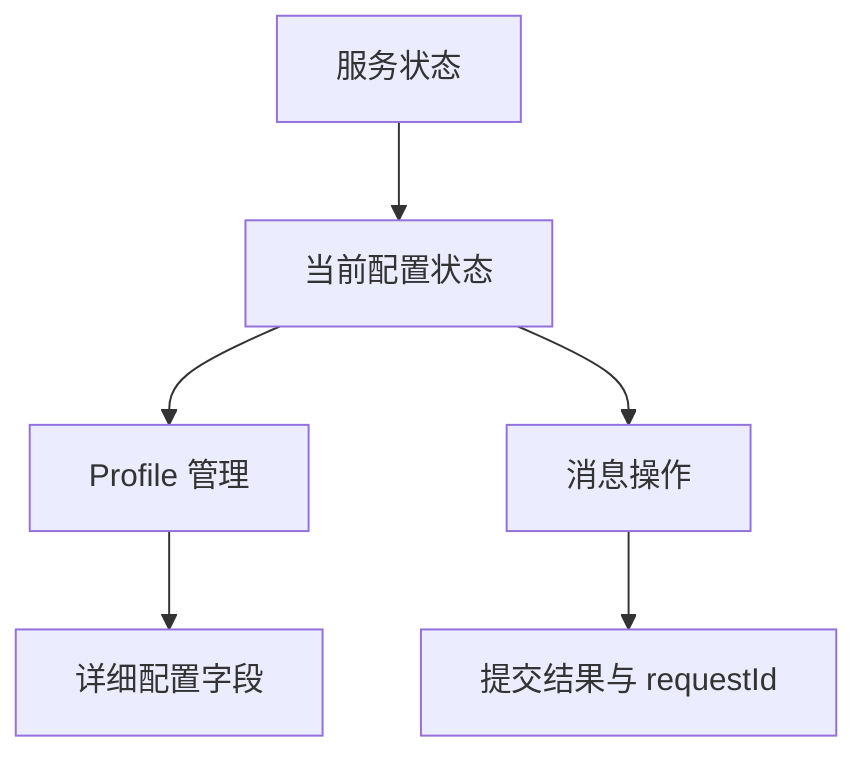

# 界面设计

Kaguya Web UI 属于 **Operate（操作型）** 界面：用户的主要目标不是浏览宣传内容，而是判断服务是否可用、完成配置并提交消息。界面应优先提供明确状态、可靠反馈和可恢复路径，而不是增加装饰性层级。

## 面向谁设计

**首次使用者** — 可能不了解 Provider、Profile 或进程重启，需要从“缺少什么”直接走到“下一步做什么”。

**日常使用者** — 希望快速确认当前 Profile，进入聊天，并在出现错误时知道消息是否已被系统接受。

**维护者** — 需要借助 requestId、配置状态和日志事件定位问题，但不应让普通用户先理解内部架构。

## 信息层级

页面先回答“现在能不能用”，再提供当前任务，最后才展示内部细节。Profile 列表和编辑表单属于配置任务；消息输入属于运行任务，两者不应在同一时刻争夺主要操作位置。

## 视觉系统

**品牌色** — 月牙图标中的橙色是主要强调色，用于主按钮、焦点和当前状态；青色霓虹用于深色主题的成功、聚焦与次要强调。

**主题** — 产品界面固定运行深色主题（`data-theme="dark"`）：深蓝夜空底色上线稿鸟居与霓虹插画只作背景层，正文始终落在卡片或面板承载面上。`:root` 保留浅色令牌基线，仅供注意力设计预览页切换，不为浅色新增投入。颜色令牌分品牌、表面、状态三层，组件只引用语义令牌，不直接书写色值；设计令牌与约定见 `apps/web/DESIGN.md`。

**形状** — 卡片与面板圆角 12–14px，按钮与输入 9–10px，胶囊只用于状态徽章与小控件；避免把每一段内容都包进嵌套卡片。

**层级** — 字号、字重、间距和边框共同表达层级：按钮与标签使用 500–600 字重，粗体只留给数值与关键词。颜色不能成为区分错误、成功或选中状态的唯一手段。

**动效** — 只用于反馈加载、保存和页面状态切换；尊重 `prefers-reduced-motion`，不让动画阻碍操作。

**图标** — 复用项目月牙图标与 lucide 图标体系。图标辅助文字，不单独承担不可猜测的操作含义。

**浏览器默认表面** — 链接、选中色、光标、滚动条与焦点环都来自调色板，不保留浏览器默认蓝色链接或默认滚动条。

**操作密度** — Profile、NapCat 和消息操作沿用现有页面状态与信息顺序。实体表面保持可读对比；窄屏改为单栏时，主要触控目标保持足够尺寸。装饰背景不承载信息，也不遮挡输入、焦点或错误提示。

### 深色主题改版对照

以下首屏分别来自 [#319](https://github.com/posanbu/Kaguya/pull/319) 合入前的 `4ebd7fe03`（左）和合入后的 `02efd8738`（右）。每组使用同一份模拟接口响应、同一浏览器和固定时间，以 1 倍像素密度、减少动态效果模式截取。桌面为 1440 × 900，手机为 375 × 812。两种宽度下的七个页面均未出现文档级横向溢出。

- **概览 · 部分功能读取失败** — [桌面对照](/images/comparisons/317/overview-1440.webp) · [手机对照](/images/comparisons/317/overview-375.webp)
- **情境 · 等待首个 tick** — [桌面对照](/images/comparisons/317/situation-1440.webp) · [手机对照](/images/comparisons/317/situation-375.webp)
- **消息 · 空对话** — [桌面对照](/images/comparisons/317/messages-1440.webp) · [手机对照](/images/comparisons/317/messages-375.webp)
- **记忆 · 数据库未就绪** — [桌面对照](/images/comparisons/317/memory-1440.webp) · [手机对照](/images/comparisons/317/memory-375.webp)
- **配置 · 已打开示例 Profile** — [桌面对照](/images/comparisons/317/profiles-1440.webp) · [手机对照](/images/comparisons/317/profiles-375.webp)
- **生效管理 · 选中配置已生效** — [桌面对照](/images/comparisons/317/application-1440.webp) · [手机对照](/images/comparisons/317/application-375.webp)
- **检查 · 模块目录为空** — [桌面对照](/images/comparisons/317/inspection-1440.webp) · [手机对照](/images/comparisons/317/inspection-375.webp)
  配置页可对照编辑区正文与背景图的分隔，生效管理页可对照字段和值的对齐方式，消息页可对照空对话的图标与输入区域。

在同一批已渲染页面上运行 Impeccable 的 DOM 检测，两种视口合计从改版前的 28 项提示降至 22 项。检查页“查找模块”的占位文字在改版前后分别为 3.7∶1 和 3.6∶1，均低于 4.5∶1。改版后的配置页另有两处需要结合实图判断：桌面和窄屏上的配置检查区出现嵌套卡片提示，窄屏上的标题字号层级也被标记。

后续在主线 `884a45470` 上复核并修正了这两页。搜索占位文字使用主题辅助文字色，对比度提升至 8.35∶1。配置页保留完整的深色底面，通过分隔线区分检查摘要与表单，窄屏标题从 22px 调为 24px。橙色主按钮的白字对比度从 4.1∶1 提升至 4.95∶1。以下图片左侧为该主线版本，右侧为修正后。

- **配置** — [桌面对照](/images/comparisons/317/followup-profiles-1440.webp) · [手机对照](/images/comparisons/317/followup-profiles-375.webp)
- **检查** — [桌面对照](/images/comparisons/317/followup-inspection-1440.webp) · [手机对照](/images/comparisons/317/followup-inspection-375.webp)

## 当前页面状态

Web UI 当前以有限状态机组织首屏：`checking`、`profiles`、`restart`、`chat` 和 `error`。页面加载时携带本实例 token 读取 Profile readiness，再决定进入 Profile 管理、重启提示或消息界面。

设计与实现的对应关系详见[配置流程设计](./configuration-flow)。用户如何实际操作见[配置 Kaguya](../guide/configuration)和[使用 Web UI](../guide/webui)。

## 模块检查的信息组织

模块页先回答“发生了什么、为什么、依据是什么”，再展示配置与技术细节。调研参考了 MaiBot 的会话、表达习惯和记忆管理界面，以及 [MaiBot 数据与记忆 API](https://docs.mai-mai.org/develop/webui-api/data-and-memory-api) 与 [AstrBot WebUI 文档](https://docs.astrbot.app/use/webui.html)：可读名称、业务字段、列表筛选和详情追溯比直接铺开 JSON 更适合作为检查入口。

Kaguya 按模块职责组织视图：注意力展示唤醒状态、观察或延后、触发信号、Focus、未读数量与注册水位；表达展示情境、风格与验证结果；记忆展示实际文档和索引元数据；调度与回合展示历史及来源。每个第一方模块在 Manifest 中声明检查视图与机制说明，由检查 API 从已有事实账本生成可读字段，不另外维护一份运行事件库。

页面默认展示摘要，正文、完整字段和原始 JSON 可逐级展开。时间、实例和类型筛选在分页前执行，来源信息可继续追溯。历史记录不冒充当前活动状态，当前配置不冒充历史决策依据；未启用向量表与查询结果为空也分别说明。移动端将列表与详情纵向排列，选择记录后将焦点移至详情。

## 事实与后续设计

本栏目供界面维护者查阅，用户操作以[用户手册](../guide/)为准。Web 已支持整条回复和当前会话恢复，配置支持显式应用；逐字输出和旧会话列表尚未提供。新设计应标明哪些能力已实现，并同步更新对应的操作指南。
