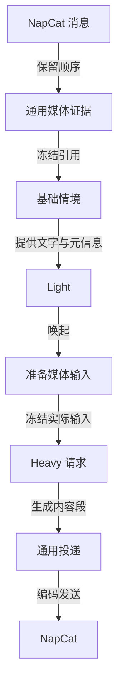

# 通用媒体与可切换识图（规划中）

::: info 方案记录，尚未实现
本文记录 [Issue #272](https://github.com/posanbu/Kaguya/issues/272) 的已确认方向。本次文档变更不修改运行代码、配置、数据库或模型调用行为。文中的拟新增字段尚不可用，不能直接写入当前配置。
:::

## 目标与范围

普通图片、静态表情和动图共用媒体证据、情境、模型请求与投递链。Heavy 在生成回复的同一次请求中决定表达内容，可以只发文字、只发表情，或按顺序组合图文。

识图采用显式三档：关闭、原生多模态、外挂多模态。原生模式由 Heavy 直接读取图片。外挂模式在 Heavy 启动后调用独立视觉模型，把描述交给 Heavy。Light 不直接看图，也不为参与判断主动调用外挂识图。

旧 `plugin.qq-expression` 按废稿处理，不作为实现或兼容基线。新方案不继承其专属学习、表情选择、限频、emoji 清理或强制补文字规则。素材获取、来源校验和平台编码属于通用媒体基础设施。

首期覆盖静态图片和动图。语音、视频、文件和合并转发保留已有元信息边界，不新增转写、视频理解或递归展开。

## 核查依据与当前缺口

首次核查日期为 **2026-10-25**，本次于 **2026-10-29** 复核。Kaguya 主线仍为 [`7edca245e382653765f7e7519d6e59323a460efb`](https://github.com/posanbu/Kaguya/tree/7edca245e382653765f7e7519d6e59323a460efb)。NapCat 源码对照固定为 [`3420f0b76d7dc0ac92cde1663f21ea27f61e13bb`](https://github.com/NapNeko/NapCatQQ/tree/3420f0b76d7dc0ac92cde1663f21ea27f61e13bb)，官方配置与文件说明于本次复核时读取。这些证据不代表已核查某个部署的实际版本或私人配置。

**普通图片信息丢失** — OneBot 正规化将普通图片转换为 `[image]`。专用表情字段仅覆盖部分结构，Runtime 没有通用媒体内容段。[OneBot 解析](https://github.com/posanbu/Kaguya/blob/7edca245e382653765f7e7519d6e59323a460efb/packages/platform-adapters/src/onebot.ts#L220)

**情境证据仍是文字** — `EvidenceInput` 用 `text` 表示内容，没有媒体内容段，冻结投影也只输出文字。仅在模板中增加图片 URL，不会让模型收到图像内容块。[情境契约](https://github.com/posanbu/Kaguya/blob/7edca245e382653765f7e7519d6e59323a460efb/packages/schema/src/situation-context.ts#L4)、[冻结投影](https://github.com/posanbu/Kaguya/blob/7edca245e382653765f7e7519d6e59323a460efb/packages/database/src/raw-event-store.ts#L553)

**原生接续尚未接通识图** — 底层 LLM 客户端可以传递数组消息，但 Heavy 当前追加的情境仍是字符串。保存原生模型返回与传入真实图片是两个能力。[LLM 客户端](https://github.com/posanbu/Kaguya/blob/7edca245e382653765f7e7519d6e59323a460efb/packages/llm/src/client.ts#L232)、[当前消息装配](https://github.com/posanbu/Kaguya/blob/7edca245e382653765f7e7519d6e59323a460efb/packages/runtime/src/native-input.ts#L181)

**出站形式受限** — 当前正文必须非空，文字后最多附加一个表情。Heavy 的结构化输出没有通用媒体引用，不能直接生成纯表情或图文混排。[出站契约](https://github.com/posanbu/Kaguya/blob/7edca245e382653765f7e7519d6e59323a460efb/packages/schema/src/index.ts#L122)、[Heavy 输出](https://github.com/posanbu/Kaguya/blob/7edca245e382653765f7e7519d6e59323a460efb/packages/modules/src/first-party/heavy/index.ts#L128)

**缺少识图配置** — 当前只有 Light 和 Heavy 模型目标，没有视觉目标、图像能力声明或三档开关。单独添加 Provider 自定义字段不会自动接通业务链。[AI 配置](https://github.com/posanbu/Kaguya/blob/7edca245e382653765f7e7519d6e59323a460efb/packages/config/src/model.ts#L59)

## NapCat 的信息与配置边界

当前连接配置见 [NapCat 指南](../guide/napcat)。`enabled`、`wsUrl`、`accessToken`、`selfId` 和 `reconnectMs` 控制适配器连接。`captureEnabled`、`captureGroups` 和 `captureQueueLimit` 控制独立采集。采集保留文字、提及、回复关系和媒体类型，不保存媒体 URL，也不提供识图能力。[采集投影](https://github.com/posanbu/Kaguya/blob/7edca245e382653765f7e7519d6e59323a460efb/packages/platform-adapters/src/onebot.ts#L78)

**消息格式** — 推荐 NapCat 正向 WebSocket 使用 `messagePostFormat: "array"`，直接上报结构化消息段。Kaguya 继续兼容 CQ 字符串。[NapCat 基础配置](https://napneko.github.io/config/basic)

**本地文件选项** — `enableLocalFile2Url` 默认不要求开启。它不是识图开关。所核对版本的 `get_file` 在开启该选项后，可额外返回文件的 `base64` 字段。NapCat 返回的本地路径属于它所在的机器或容器，不能直接当作 Kaguya 的可读路径。[固定版本实现](https://github.com/NapNeko/NapCatQQ/blob/3420f0b76d7dc0ac92cde1663f21ea27f61e13bb/packages/napcat-onebot/action/file/GetFile.ts#L59)

**合并转发** — `parseMultMsg` 控制合并转发内容展开。当前 Kaguya 不消费展开内容，单独开启它不会获得识图能力。

**临时图片链接** — NapCat 官方文档说明，图片 URL 约两小时过期，可通过 `get_image`、`get_file` 或 `get_msg` 刷新。拟议媒体接入层优先获取 URL 对应字节，必要时查询 NapCat，再保存稳定副本。没有可取得的字节时，保留明确的不可用状态。[文件处理说明](https://napneko.github.io/develop/file)

**商城表情兼容** — 接收端需要兼容显式 `mface`、旧版表情图片，以及带 `emoji_id`、`emoji_package_id`、`key` 的新版 `image`。所核对上游会把部分商城表情编码为 `gxh.vip.qq.com` 上的 GIF，没有 `sub_type=1` 或 `file=marketface`。当前解析器会漏掉这种表情结构。这是源码对照结论，尚未证明某个部署受影响。[上游编码](https://github.com/NapNeko/NapCatQQ/blob/3420f0b76d7dc0ac92cde1663f21ea27f61e13bb/packages/napcat-onebot/api/msg.ts#L258)

## 拟新增识图配置

以下字段是设计接口，尚未实现。

**`ai.vision.mode`** — 取值为 `off | native | external`，缺省为 `off`。模式只由显式配置决定，不在运行失败时自动切换。

**`ai.modelTiers.vision`** — 外挂视觉模型目标，复用已有 Provider、模型身份及超时配置。`external` 模式要求配置此目标。

**模型图像能力** — 按具体模型目标声明，不能只按 Provider 声明。应用 `native` 时校验 Heavy，应用 `external` 时校验 vision 目标。配置声明仍须通过实际请求验收。

**配置生效** — 设置页沿用“保存后显式应用”的流程。切换只影响新请求，已冻结请求继续使用原输入和模型身份。

三档的模型输入分别为：

- **`off`** — Heavy 收到文字、媒体引用和不可见状态，不发起新的识图调用。
- **`native`** — Heavy 在同一次主回复请求中收到文字和真实图像内容块，没有独立识图调用。
- **`external`** — Heavy 启动后按需调用 vision 目标，再把可追溯描述放入主回复请求。Heavy 本身可以是纯文本模型。

关闭识图不删除历史媒体或已形成的文字记忆，也不等同于禁止发送已有可用素材。

## 通用媒体进入情境与请求

从顶部消息开始读取。图中的媒体准备阶段按配置选择原生图片、外挂描述或不可见标记。

### 来源、存储与基础情境

入站保留有序文字和媒体内容段。媒体使用稳定 `mediaId`，关联原消息、消息内位置、会话范围、文件类型和平台发送信息。表情用途作为媒体属性保留，不建立第二套表情使用流程。

媒体存储独立于长期 Memory。通过内容摘要去重，在数据库媒体存储中保存图片字节，账本与情境保存引用。字节去重不合并来源权限。入站授权通过后可提前缓存，以减少临时链接失效，但缓存不触发视觉模型。

基础情境先冻结。Light 依据文字、来源和媒体元信息决定参与、等待或沉默，不因图片存在而强制唤起 Heavy。Light 不接收真实图片，也不等待本轮外挂识图。

### Heavy 的不可变媒体输入

Heavy 完成授权和上下文选择后，准备本次请求的媒体输入快照。快照关联基础情境、来源消息、素材摘要、抽帧清单和处理状态。它补充本次实际输入，不改写 Light 使用过的旧情境帧。

原生模式把图片或抽帧编译为模型协议支持的图像内容块。外挂模式先通过受控 ModelTask 取得视觉观察，再冻结观察及其模型身份、完成时间和来源。主回复请求引用该快照，不能把描述冒充用户原话或用消息时间冒充识图时间。

外挂视觉模型描述画面、可见文字和动作变化，并保留不确定性。表情在当前对话中的意思、是否回复和如何表达，由 Heavy 判断。已完成观察按素材摘要、识图模型、提示词版本和抽帧规则复用。

首次回复、逐段接续和记忆补查后的 Heavy 请求共用输入准备入口。存在已持久化请求时，恢复冻结输入，不重新下载、抽帧或识图。超时后的迟到结果只能作为后续请求的新证据。

### 动图、预算与失败

动图保留原件。识图使用有序抽帧，并保存帧时间点。首期建议每个动图最多四帧，按时间均匀采样并覆盖首尾。发送时使用原动图。

首期建议每次视觉输入最多四个素材，单个原件上限 10 MiB。优先当前输入，再纳入历史或召回素材。超过预算的部分明确标记省略。这些数值是待实现验证的初始默认值，不是当前配置或已验证的模型上限。

图像数量、尺寸和总媒体字节应有独立预算，不能把 base64 全量塞进现有文字预算。最终消息和媒体清单冻结后，再计算请求摘要。切换模式、素材或抽帧应形成不同的新请求身份。

下载或外挂识图失败时，快照记录不可见状态，Heavy 可继续处理文字。原生模型拒绝图像时，沿现有模型任务失败流程报告，不隐式调用外挂。媒体缺失、识别失败和“图片中没有相关内容”必须区分。

## 统一输出与长期复用

Heavy 的 `message` 输出拟采用有序内容段，支持 `text` 和 `mediaRef`，允许纯媒体消息。继续保留 `silent`、`recall` 与 `continuation`。Unicode emoji 可作为普通文字输出，不经过专属清理。

投递层只接受本次请求可用资源中的 `mediaId`，验证来源范围、目标权限和可发送状态。模型不能自行指定任意文件路径或下载地址。适配器按素材类型编码为 OneBot 的 text、image、face 或 mface，保持图文顺序和原动图。

长期复用沿现有 Memory 形成与召回流程增加 `mediaRefs`。当前情境中的媒体独立于长期 Memory，关闭 Memory 后仍可识图和使用当前素材。

原生模式只让 Heavy 看图。仍使用文字输入的 Memory 形成过程只能保存媒体引用与已有文字依据，不能凭空生成视觉描述。外挂模式可把已经完成的视觉观察作为有来源的派生证据。召回后，Heavy 按当前模式读取素材。

## 公共接口与兼容边界

**输入与情境** — 入站消息、情境证据和 Memory 来源增加可选媒体引用，允许纯媒体来源。旧文字记录继续可读。TypeScript 类型、运行时校验和导出契约保持一致。

**模型请求** — ModelTask 统一装配媒体输入和请求身份。来源清单、实际模型、媒体摘要和观察版本随请求保存，保留原生接续与重放边界。

**输出与投递** — 增加有序通用内容段。历史纯文字记录保持可读，新路径使用现有授权、投递和实际回执，不以“生成成功”代替“发送成功”。

**检视** — 在对应 Heavy 请求下显示实际模式、媒体预览、抽帧、外挂描述和失败状态。基础情境与请求补充证据分别展示，避免把 Heavy 后来知道的内容显示为 Light 当时已经知道。

这些是后续实现需要覆盖的接口变化。本次文档整理不修改 schema、运行配置、旧模块启停状态或存储结构。

## 验收与已知限制

以下项目均为后续验收要求，尚未完成新增识图能力的验收。

1. 同一图片在三档下分别产生不可见标记、真实图像内容块和外挂描述。检查实际模型请求，不能只检查提示词预览。
2. Light 沉默时没有外挂识图调用。Heavy 启动后才按需识图，已完成的同版本观察可复用。
3. 普通图片、新旧商城表情和动图均能接收。纯媒体输入不会因缺少文字被过滤，超预算时保留明确状态。
4. Heavy 能生成纯文字、纯表情和图文混排。发送保持顺序与动画。验收时停用废稿模块，新链路不依赖其学习或选择。
5. Memory 关闭时仍能使用当前素材。开启时保存与召回合法媒体引用，不编造视觉记忆。
6. 超时、损坏图片、过期 URL、预算不足和非法素材引用均有明确结果，不伪造理解或扩大来源权限。
7. 配置切换只影响新请求。重放复用旧素材、抽帧和描述。迟到结果不改写旧帧或旧请求。
8. 来源校验、会话隔离、原生接续、投递幂等及失败恢复的现有测试继续通过。真实视觉模型验收与确定性协议测试分别报告。

本方案接受一个明确限制：Light 不理解本轮图片内容，可能错过仅存在于图片中的回复意图。当前方案不通过额外识图或强制唤起绕过这一选择。

## 关联实现的边界

旧表情 PR [#292](https://github.com/posanbu/Kaguya/pull/292) 和 [#305](https://github.com/posanbu/Kaguya/pull/305) 已按废稿关闭。它们的测试结果不能代替本方案的识图、纯媒体和图文混排验收。当前代码仍保留旧模块，本次文档变更不修改它的启停状态。

出站 TTS 由 [#214](https://github.com/posanbu/Kaguya/issues/214) 单独追踪，隔离 GUI 的截图与执行由 [#303](https://github.com/posanbu/Kaguya/issues/303) 追踪。[DSH 草案](./situation-model/dsh-cognition)保留自身的实现与验证边界。这些能力均不能代替本页的通用媒体链路验收。
