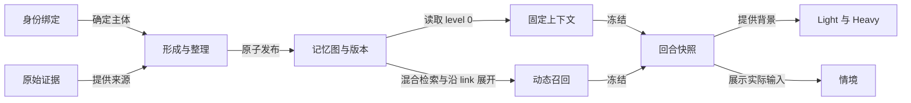

# Memory 模块边界

`memory.native` 是统一运行模块。领域契约位于 `packages/memory`，PostgreSQL 实现位于 `packages/database`。composition 注入模型提供方，runtime 注入存储能力。模块不直接查询其他模块的私有存储。

身份模块保留账号、会话和人物绑定。关系、经历和表达使用统一图。QQ 插件保存素材、收集文字上下文、提供用法推断并执行发送限额。推断作为带来源的观察进入 Memory，候选语义从 Memory 读取。旧 Raw 文档、表达学习和 Mem0 模块及其契约、存储接口、模板和查询页面已删除。配置采用不兼容切换，不做自动转换。

## 图与发布契约

`memory_nodes` 继续只有 `id`、`metadata` 和 `content` 三列。新节点使用 `metadata.system = native-v1`。metadata 记录 `kind`、`ownerId`、`scope`、`level`、`revision`、`status`、`locked`、`sourceIds`、`aliases`、`occurredAt` 和 `tags`。

同一 `ownerId` 和 `scope` 最多有一个有效 level 0，由 PostgreSQL 部分唯一索引保证。节点 ID 不随 level 变化。`summarizes` 要求起点 level 小于终点 level，普通语义连结没有层级含义。

`publish` 接收操作 ID、修改者、预期版本、完整节点和连结变更。在同一事务中更新图、全文索引和 `memory.native.revision.v1` 账本记录。相同操作可重放，内容不一致的重用被拒绝。通用图写接口不能修改托管节点或相关连结。

自动发布要求真实来源，禁止覆盖手动锁定的正文。细节修订后，未同步更新的祖先摘要失效。历史版本保存在追加式账本及发布记录中。向量是可重建投影，不是权威事实库。

管理端通过 `POST /api/v1/memory/publications` 发布。`GET /api/v1/memory/nodes/:id/history` 返回修订，`GET /api/v1/memory/status` 返回处理状态。图查询支持类型、对象、level、状态和旧有正文／标签／时间筛选。表达视图区分习惯、文本示例和 QQ 资源，分类与 level 独立。关系编辑也必须提交两端的预期版本。

## 固定读取与回合快照

固定读取只检查对象、作用域、有效状态和时间，不使用查询词、相似度、排名或数量限额。本轮全局背景和当前会话背景中的所有人物、当前会话、自身及表达对象构成读取范围。人物包括历史发言者、明确提及及回复对象，以及背景内身份绑定记录中的人物。选择器按冻结 Raw 的来源 ID 读取证据，按平台和适配器分别解析明确账号绑定，不按昵称绑定。每个人的适用 level 0 都进入固定快照，即使本轮没有发言。跨会话内容仍受当前作用域与共享范围约束。

本人在群聊明确表达的普通稳定背景可以使用 `shared`。自我认识和自身表达沿用共享规则。具体经历、第三方信息、暂时推测、私聊内容和限定场合的信息保留来源 scope。远程辅助候选先在共享期限内返回，不占用图读取事务。随后在 PostgreSQL 一致性快照中读取固定条目和图候选，并核验辅助候选的节点版本。

固定与动态内容保存在 `SituationFrame.memory`。Light 在参与判断前读取。普通 Heavy 回复复用该回合的版本。Prompt 编译器强制追加 `native_memory` 数据区块，用户模板省略变量也不会漏掉固定摘要。授权跨会话发送保持独立的已批准正文路径，不转发原会话的记忆。

动态正文默认 4000 个 Unicode 字符，附加表达最多 3 条、合计 1000 字符。固定摘要不占这些额度。最终 Prompt 的装配上限为 128000 UTF-8 字节，超限时先移除动态召回，再移除可选的全局近期背景。仍超限时明确失败，固定摘要不能静默遗漏。实际发送的变量与最终文本一起保存。

情境 FAB 按所选请求展示固定条目，召回区展示动态内容。旧请求没有该字段时显示“未记录”，不能用当前图补写历史。

## 检索与索引

检索先执行统一的作用域、状态和时间过滤，再组合实体图候选、显式引用、全文、字符片段及可选的两类向量候选。全文使用 `tsvector`、GIN 和 `ts_rank_cd`。规范化使用 NFKC，中文使用重叠二元片段和短词单字路径。模糊匹配对有界候选计算编辑距离。

各路候选默认最多 50 条。显式引用先保留，其余用 RRF 融合，常数为 60。相同配置的向量检索不重复投票。level 不参与分数。RRF 分数不表示事实置信度。

普通关系展开一跳，摘要关系最多展开四轮，合计最多 100 个节点。每个中间节点都检查作用域。图与 link 是语义联系的权威来源，向量命中不会创建连结或合并身份。

语义和字面向量分别配置。pgvector 投影绑定用途、模型身份、节点版本和输入哈希。后台每轮最多补建 50 个节点，启动、版本发布和周期检查推动重建。检索不等待索引构建。辅助查询共享默认 2 秒期限，失败记录渠道降级，图和文本仍可用。更换模型后只使用新身份的向量。

以上采用分阶段候选与排序设计，参考 [Vespa phased ranking](https://docs.vespa.ai/en/ranking/phased-ranking.html) 和 [OpenSearch RRF](https://docs.opensearch.org/latest/vector-search/ai-search/hybrid-search/rrf/)。这些设计依据不代表本项目已经获得相同的检索效果。

## 运行边界

形成批次默认 8 条或 60 秒触发，最多 24 条来源。批次、模型请求和发布操作分别持久化。失败批次可在检查页重新排队，原失败记录保留，新批次产生新的模型请求。来源按会话串行认领，重启可以继续处理。成功的空结果记录完成，但不创建虚假经历。

新 epoch 保存原始账本位置。旧领域数据不迁移，旧派生内容不进入在线 Raw 背景。记忆开关仅控制 `memory.native`。原始事件投影和普通回复不依赖该开关。

从身份绑定和原始证据开始，固定读取与动态召回分别进入同一回合快照。

## 人物来源与请求投影

`MemorySource` 区分 `inbound` 和 `delivered`。`participants` 保存明确账号绑定的 `ownerId`、发言／提及／回复角色、昵称和群名片。参与者观察沿用该来源的 ID、作用域和发生时间。未解析或绑定冲突的对象保留 `null`。`replyTo` 保存原生回复引用，没有被引用正文时不能推断其内容。

形成请求永久使用 `memory.native.formation.requested.v1`，持久订阅固定为实例 ID 加 `memory.native.form`。字段调整直接更新现行契约，不增加 v2 事件、订阅或兼容读取分支。整理读取本批相关人物的已有版本。姓名和语义相似不能创建身份绑定。自身成功投递的消息只证明说过这些话，不能独立证明对方的身份和关系。

`bootstrap` 使用版本 2，仅保存人物及会话的建档来源、记录时间，以及是否由本轮输入创建。它不输出认识程度。`context_bootstrap` 在最终装配时更新 `fixedMemoryCount`、`recalledMemoryCount` 和 `memoryStatus`。`sourceReferenceCount` 单独统计显式引用的原始消息。动态记忆因预算移除后，同步更新计数和人物节点引用。

冻结的账号与人物映射随记忆快照保存。`conversation.background.participants.ownerId` 将人物卡片连接到同一请求的固定摘要。跨会话发送的背景仅保留名称和参与角色等最小字段，不带账号 ID、人物记忆或原会话来源 ID。

## 人物画像与主动补查

**最小摘要** — 情境冻结前，Memory 根据当前入站原话补齐人物和会话的 level 0。人物必须有明确账号绑定，提及或同名不算本人发言。初始摘要只说明在此会话中有过交流，不判断亲密程度。补齐与图发布共用事务锁，重复调用不会生成第二份摘要。已有摘要、手动修订和锁定记录不被补齐操作覆盖。

**背景证据** — 人物细节继续使用 `person` 节点。可选的 `evidence` 保存 `basis`、`temporality`、`observedAt`、`sourceScope`、明确给出的 `validFrom` 与 `validUntil`，以及 `supersedes`。旧节点缺少该字段时保持未分类。`basis` 区分本人自述、第三方描述、观察和推测。`temporality` 区分稳定背景、近期状态和未分类。字段校验不能判断原话是否真的支持模型概括，仍需逐例核对。

**修订** — 更正或撤回可修订原节点，也可通过 `supersedes` 指向旧细节。后一种方式要求同批将旧细节设为失效或归档。摘要通过 `summarizes` 引用细节，同步修订受影响的摘要。没有同步修订的祖先摘要继续按现有规则失效。

**人物候选** — 检索可返回当前范围和共享范围中的相似人物摘要，最多五个。候选包含对象 ID、摘要版本、匹配方式和来源。候选正文最多占动态预算的 2000 字，每个最多 1200 字，裁剪状态单独记录。候选不会进入账号绑定，也不会单凭相似性成为确定身份。

**Heavy 补查** — 普通回复增加 `recall` 动作，包含查询和可选候选节点 ID。宿主沿用原情境的范围和时间边界执行查询。`agent.heavy.recall.requested` 保存请求，`agent.heavy.recall.completed` 保存结果或失败状态。后续 Model Task 使用独立结果，不修改 `SituationFrame.memory`。重放已完成请求读取保存结果。

**表达预算** — 每次完整表达最多主动检索两次。接续段继承 `memory_recall`，不重置额度。检索不生成草稿、不推进接续观察水位，也不结束回合。额度用尽时，输出协议只允许回复或沉默。Light 沿用自动召回，不调用主动检索。

**自然交流** — Memory 只整理真实来源。Heavy 按当前话题使用相关背景，并自行决定是否追问。已知信息不重复询问，对方不展开时收住。近期状态结合时间使用，当前要求和更正优先于旧倾向。没有资料填写目标，也没有新增定时联系。

检查 API 和情境界面区分检索完成、检索失败与投递回执。人物背景面板展示所选请求实际使用的摘要、细节、候选与补查结果，不从当前图补写旧请求。结构测试验证范围、版本和重放机制。自然度及背景使用是否恰当仍需同模型多轮对照和真实交流验收。
