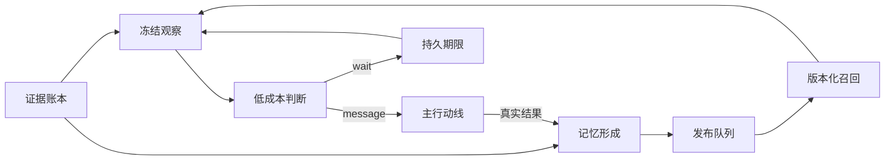

# DSH 观察与记忆

本页供两端维护者核对实现边界。基线为提交 `8e75bea230b8ab5df8e08897be305855d9fc8471`，记录日期为 2026-10-20。Kaguya 已接入运行链的代码是行为真值。DSH 先行能力只有完成 Kaguya 接线及验收后，才能列为两端共同运行能力。

## 三个插件

| 插件                        | 拥有的状态                                       | 不承担的职责                  |
| --------------------------- | ------------------------------------------------ | ----------------------------- |
| `dsh-kaguya-scene` 0.3.0    | 证据、观察记录、主行动线、情境帧、运行控制、投递 | 自动生成记忆                  |
| `dsh-kaguya-observer` 0.1.0 | 独立模型配置、观察规则                           | 工具执行、外部发送            |
| `dsh-kaguya-memory` 0.1.0   | 形成任务、节点修订、关联、发布队列               | 物理 Session 管理、完整经历层 |

两个配套插件只通过 `sceneRuntime` 1.0.0 服务访问场景数据。接口提供证据分页、来源失效检查、行动摘要、能力注册和召回发布。Scene 独占观察冻结、观察提交及 Session 绑定，插件无法通过 Remote 指定任意 Session。旧安装保留直接唤醒模式，新能力默认关闭。

从证据账本开始读取。观察与形成使用独立进度。`silent` 仅完成观察，不推进主模型步骤或形成进度。

## 共享代码的边界

`packages/agent-contracts` 是不依赖宿主、SDK 或数据库的纯代码包。0.1.0 提取现有 Light 的目标与动作校验，以及已用于图存储的节点和边校验。原调用点重新导出这些校验，保留旧导入路径。默认 Router 的失败降级行为保持原样。

包内 `provenance.json` 指明提取基线和原文件。DSH 以随包归档的 tarball 固定版本，并在 `upstream.json` 记录 SHA-256。这里的来源提交是提取基线，不表示该提交已经包含新包。情境契约仍为 1.0.0，来源是已合入的 PR #285。

`ObservationRecord`、自动形成规则、观察覆盖范围和行动记忆依赖属于 DSH 扩展。它们不进入 Kaguya 共同契约。两端的新增行为不能仅靠名称相同推定一致。

## 观察、冻结和恢复

本地与群输入继续共用 500 毫秒合并等待和 2 秒最大窗口。Scene 到期后冻结总背景、当前情境、召回及行动摘要。Observer 仅使用独立配置的官方模型服务。`message` 交还同一份冻结清单，`wait` 保存期限，`silent` 保留可查询观察记录。

后到输入及召回修订不改变冻结清单。沉默观察用独立水位限制后续上下文，并保留覆盖说明。旧证据仍在账本中。模型超时、无效输出或预算不足最多尝试三次，随后保留受阻积压。同一证据范围最多连续等待三次，继续等待会受阻。主行动线需要处理的已结束工具结果绕过参与性否决。

显式重试复用观察证据。模型配置变化后，重试建立后继观察并保留旧记录。此行为区别于 Kaguya 部分路径降级为 `silent`，不回写 Kaguya 默认 Router。

暂停停止领取新模型任务，已开始任务登记结果后停止。重启读取持久状态。浏览器关闭只结束订阅。物理 Session 仍由 Scene 管理，未闭合工具调用不得轮换。

## Memory 首版

形成默认等待静默 30 秒，最长 5 分钟。每批最多 100 条新证据，并检查显式输入预算。分页水位只在校验及提交成功后推进。模型配置、输入和已有节点版本随任务冻结，结果先持久保存，再进行服务端校验。

节点保留陈述者、主体、情境、来源、时间、不确定性和修订号。新增、修订、失效均写入不可变版本。修订必须匹配预期版本。版本竞争或来源失效产生后继任务，旧模型结果仍可审计。旁观者来源不能修订另一陈述者的节点。模型仍可能误解指代，这需要真实模型评估。

召回按文本二元片段、标签和一跳关联匹配，默认最多 8 项。先保留最多 4 项文本命中，再加入关联项，剩余位置用文本命中补足。排序使用分数、修订顺序和身份。每项返回记忆身份、修订号、匹配依据和来源。读取会立即检查来源及版本有效性，历史版本保留供审计。

两个数据库没有共同事务。Memory 先提交节点与进度，再通过持久发布队列更新 Scene。发布使用稳定版本去重。相同召回不重复发布，召回通知不参与形成。新行动保守地依赖冻结帧中全部记忆命中，执行前再次检查。旧行动不补造依赖。

首版不接 embedding 或 Mem0，不实现完整经历的分段、封口、重开、合并和拆分。

## 实现与 issue 对照

| 对齐项                                               | 当前运行能力        | DSH 先行实现                     | Kaguya 待接入                     |
| ---------------------------------------------------- | ------------------- | -------------------------------- | --------------------------------- |
| [#247](https://github.com/posanbu/Kaguya/issues/247) | Router 已冻结上下文 | 持久观察、独立水位、重试         | 与开放 PR #255 协调，不复制其工作 |
| [#265](https://github.com/posanbu/Kaguya/issues/265) | 图存储及校验        | 自动形成、修订、召回、发布       | `memory.native` 的运行链接线      |
| [#248](https://github.com/posanbu/Kaguya/issues/248) | 来源与图修订基础    | 来源约束、版本冲突恢复           | 完整经历层                        |
| [#249](https://github.com/posanbu/Kaguya/issues/249) | 现有行动与回执链    | 观察失败、等待上限、记忆依赖检查 | 默认 Router 的相应运行迁移        |
| [#250](https://github.com/posanbu/Kaguya/issues/250) | 现有检视能力        | 独立主页观察与记忆检视           | Kaguya 贯穿验收                   |
| [#266](https://github.com/posanbu/Kaguya/issues/266) | Mem0 未接入         | 首版不接 Mem0                    | 保持原任务状态                    |

插件交付不关闭以上 Kaguya issue。DSH 实施项为 [#286 Memory](https://github.com/posanbu/Kaguya/issues/286)、[#287 Observer](https://github.com/posanbu/Kaguya/issues/287) 和 [#288 分层验收](https://github.com/posanbu/Kaguya/issues/288)。这些任务不替换原验收条件。

## 验证边界

分别记录契约回归、官方 DSH 服务集成、合成浏览器检查和真实模型评估。确定性测试可以证明版本、水位、恢复与协议约束，不能证明观察不会遗漏重要请求，也不能证明记忆正确归属人物。

真实评估固定 provider、model、规则版本、输入预算和输出上限。使用相同群聊轨迹比较直接模式与观察模式，记录主模型唤醒次数、全部模型 token、重要请求遗漏和错误唤醒。未知用量不按零计。通过这些评估后再用于长期运行，不预先承诺节省比例。
