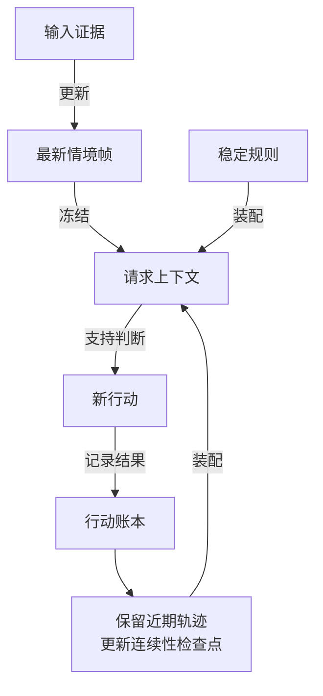

# 情境—行动上下文模型

这个模型把持续变化的环境和持续发生的行动放入同一个有界上下文。它面向长期参与群聊、工具任务和本地对话的 Agent。环境可以频繁更新，已经发生的行动仍保留当时的依据和实际结果。

本组页面定义独立的领域契约。框架、数据库和模型消息角色放在[实现映射](./implementations)中说明。规范成立、组件实现和真实部署通过验收是三个不同状态。

## 要解决的问题

只追加聊天历史会积累旧时间、旧召回和旧场景。每次只提供最新环境，又容易丢失 Agent 已做的工作、等待中的结果和未兑现承诺。

本模型让情境帧替换旧情境，让行动账本保留事实。每次请求从这两种状态中形成完整输入。入站信息没有“一条消息必须对应一条回复”的含义。

## 四类上下文

**稳定规则** — 身份、能力、行为约束与结构定义。配置变化时发布新版本。

**连续性检查点** — 较早行动的有来源归纳，保留仍有关的结果、任务、承诺与历史索引。

**最新情境帧** — 同时固定总背景、当前情境、召回版本和变化说明。新帧替换旧帧。

**近期行动轨迹** — 最近完整行动单元及未闭合交互。行动单元保留意图、依据、调用、结果和后续处理状态。

从顶部的输入证据开始读取，再沿行动账本返回后续请求。每次请求只使用已冻结的输入。图中的循环说明依赖关系，不表示每条证据都触发模型调用。

## 贯穿示例

群 A 要求继续查询。Agent 在情境帧 F40 上开始工具任务 A12。群 B 的新消息更新总背景，同时保留其群归属。A12 的依据没有变化。

随后群 A 要求停止查询。F41 纳入这条新证据。A12 已执行的部分保留，剩余工作进入取消流程。工具若先返回结果，系统记录实际结果，再判断是否需要回应。

这个过程跨群、跨情境帧，但属于同一个 Agent 的主行动线。连续性不要求所有旧原文永久驻留模型上下文。原文留在外部账本，检查点和引用支持恢复。

## 阅读顺序

1. [对象与关系](./objects)：明确每个对象拥有什么事实。
2. [上下文装配](./assembly)：说明冻结、变化说明和预算。
3. [行动连续性](./continuity)：说明依据、检查点和历史查询。
4. [更新与恢复](./recovery)：说明更正、取消、未知结果与重启。
5. [实现映射与验收](./implementations)：说明两端支持状态与共同样例。
